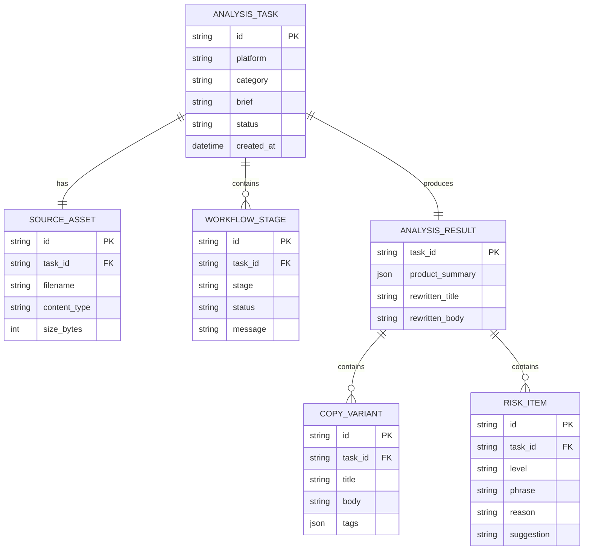

# 数据结构设计

## 1. 任务实体



## 2. API DTO 示例

```json
{
  "id": "task_123",
  "platform": "xiaohongshu",
  "category": "snack",
  "status": "completed",
  "stages": [{"stage": "review", "status": "completed", "message": "发现 1 个可优化表达"}],
  "result": {
    "product_summary": {"name": "海盐坚果脆", "category": "零食", "selling_points": ["酥脆", "便携"]},
    "copy_variants": [{"title": "办公室抽屉里的酥脆补给", "body": "...", "tags": ["#办公室零食"]}],
    "risks": [{"level": "medium", "phrase": "0添加", "reason": "缺少资料支撑", "suggestion": "改为配料表可核验的表述"}],
    "rewritten": {"title": "一口酥脆的办公间隙", "body": "..."}
  }
}
```

