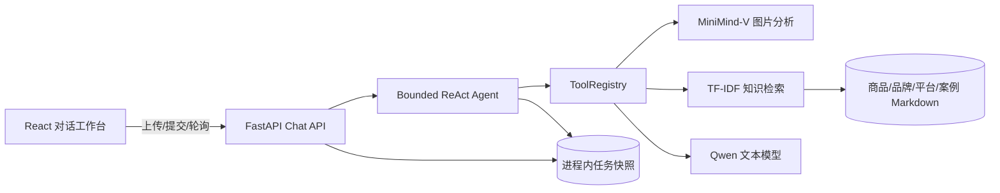
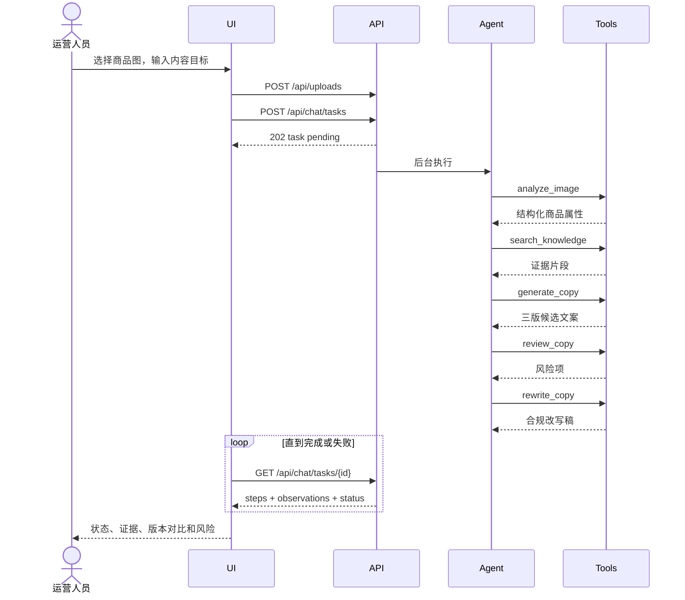
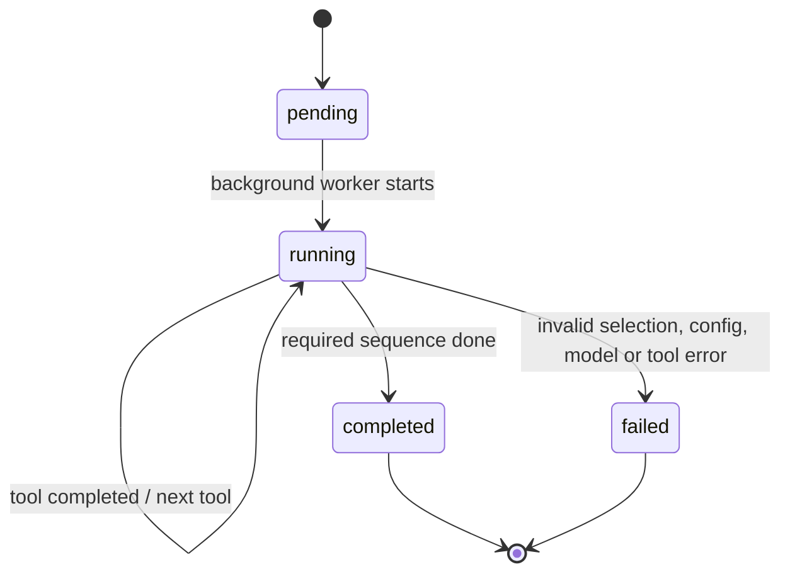

# Milestone 3 UML

## Component diagram

## Sequence: full campaign

## Tool state machine

工具顺序由意图决定：campaign = image → search → generate → review → rewrite；knowledge = search；visual = image；review = review → rewrite。Agent 不存储或展示模型内部推理，只返回工具状态和业务观察结果。
