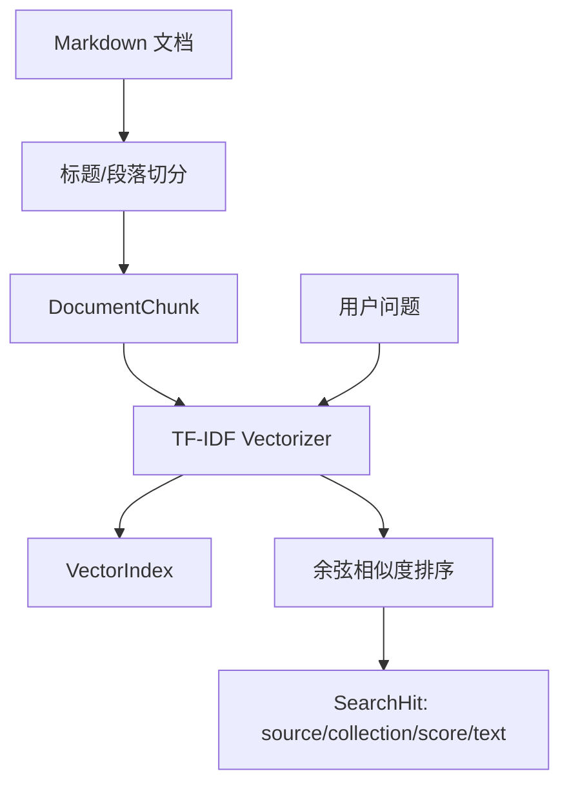

# Milestone 2 RAG 知识库

## 集合

| 集合 | 目录 | 用途 |
| --- | --- | --- |
| product | `backend/knowledge/product` | 演示商品描述、核验清单 |
| brand | `backend/knowledge/brand` | 演示品牌语气和禁用表达 |
| platform | `backend/knowledge/platform` | 非官方小红书风险提示样例 |
| cases | `backend/knowledge/cases` | 虚构的标题、正文和场景案例 |

## 索引流程

## 当前实现边界

索引保存在进程内，API 重启后需要重新调用索引接口。当前知识库仅为虚构演示资料，不能视为平台正式规则或商品真实凭证。Milestone 3 或 4 可把索引迁移到持久化向量数据库，并把检索结果接入 Agent 上下文。

