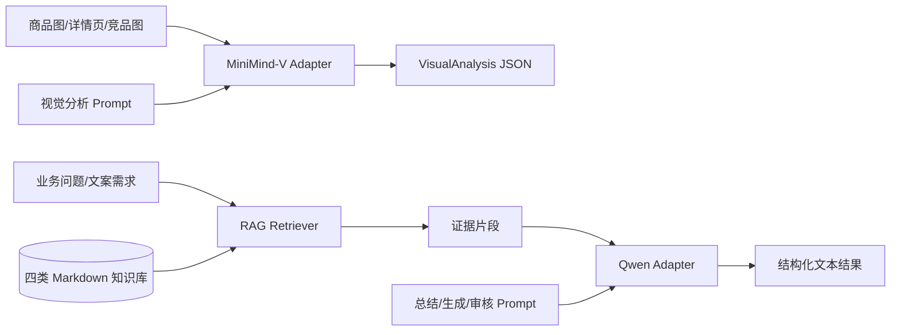

# Milestone 2 设计说明

## 目标

在 Milestone 1 的上传与任务 API 基础上，接入本地 MiniMind-V 多模态推理、可配置的 Qwen 文本模型，并建立四类业务知识库的切分、向量化和检索能力。Milestone 2 输出结构化素材分析、文案/审核调用契约和 RAG 验证接口，但不实现 Milestone 3 的 ReAct Agent、工具注册和对话编排。

## 范围

- MiniMind-V：商品图片、详情页截图、竞品素材统一接受图片路径，返回结构化 JSON；模型加载采用懒加载，避免 API 导入时加载数百 MB 权重。
- Qwen：通过 OpenAI 兼容 Chat Completions 接口完成商品总结、文案生成和内容审核；API 地址、模型名、密钥使用环境变量。
- Prompt：为视觉分析、商品总结、小红书文案和内容审核建立版本化模板。
- RAG：建立商品资料库、品牌规范库、平台规则库、优秀案例库；实现 Markdown 文档切分、TF-IDF 向量化、余弦相似度检索。
- API：新增 `/api/analysis/visual`、`/api/text/generate`、`/api/rag/index`、`/api/rag/query`、`/api/rag/ask` 验证接口。

## 非目标

- 不实现 ReAct Agent 和自动工具选择。
- 不实现生产级向量数据库、分布式索引和异步任务队列。
- 不把模型权重、API Key 或运行时生成的索引提交到代码仓库。
- 不把模型原始自然语言强行当成结构化结果；解析失败时返回明确错误。

## 技术决策

1. MiniMind-V 使用项目内原生权重，封装层通过 `MiniMindVLM`、`VLMConfig`、`MiniMindVLM.image2tensor` 和 `generate` 调用；默认 CPU，可通过 `MINIMIND_DEVICE=cuda` 选择 GPU。小模型不保证直接输出 JSON；直接输出有效结构时使用，否则把原始视觉描述交给 Qwen 整理，保留 `raw_description` 供核对。
2. Qwen 使用 `openai` Python SDK 的兼容模式，默认 endpoint 为 DashScope compatible-mode；通过依赖注入支持测试和后续供应商替换。
3. RAG 初版使用 sklearn `TfidfVectorizer`，优点是本地可复现、无需下载 embedding 模型；`VectorIndex` 保持独立接口，后续可替换为 SentenceTransformers 或 Milvus/FAISS。
4. 视觉、总结、文案和审核输出经过 Pydantic 校验；Qwen 采用 JSON response format，解析失败返回 `ModelOutputError`。RAG 问答校验 `answer` 为非空字符串。

## 业务数据流

## 可靠性边界

- 本地模型路径不存在时，在首次调用视觉接口时报告配置错误，不静默返回虚假视觉结果。
- Qwen 未配置 API Key 时，验证接口返回 503 并说明配置方式；RAG 接口仍可独立使用。
- 索引为空或查询无匹配时返回空列表和状态信息，不伪造证据。
- 所有检索结果携带 `source`、`collection`、`score`，供后续 Agent 生成依据展示。

