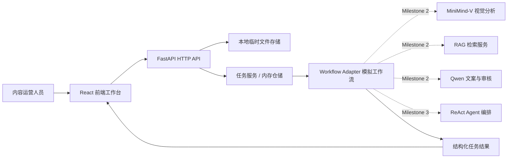
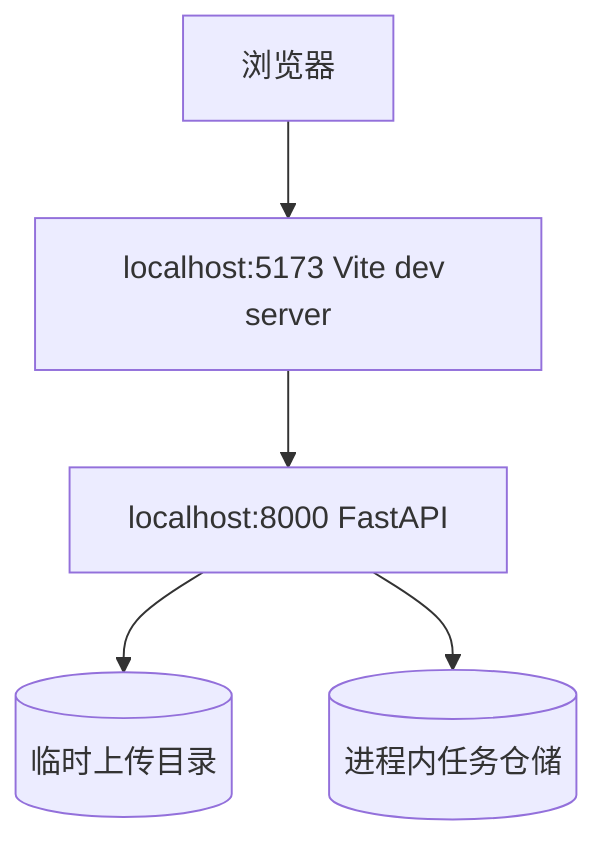

# 系统架构设计

## 1. 架构目标

以最小可运行闭环验证业务流程，同时把模型适配、任务编排和结果结构隔离出来，方便 Milestone 2 接入 MiniMind-V/Qwen/RAG，Milestone 3 接入 ReAct Agent。

## 2. 分层架构

## 3. 当前阶段模块职责

| 模块 | 职责 | 当前实现 |
| --- | --- | --- |
| 前端工作台 | 上传、提交、状态与结果展示 | React 单页 |
| HTTP API | 文件与任务接口、参数校验 | FastAPI |
| Task Service | 生成任务、更新阶段、读取结果 | 内存字典 |
| Workflow Adapter | 生成可演示的阶段结果 | Deterministic mock |
| Model/RAG/Agent | 真实智能能力 | 仅保留接口边界 |

## 4. 部署视图

生产化时需要替换临时目录、内存仓储、CORS 配置和模拟工作流；本阶段刻意不提前引入数据库、消息队列和鉴权。

